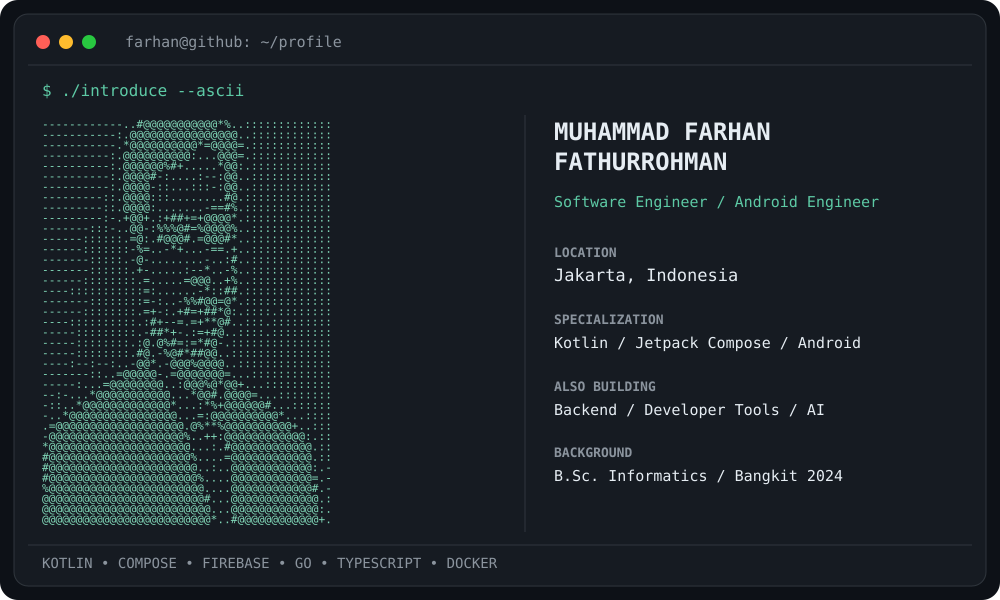

<div align="center">

<picture>
  <source media="(prefers-color-scheme: dark)" srcset="./assets/dark_mode.svg" />
  <source media="(prefers-color-scheme: light)" srcset="./assets/light_mode.svg" />
  
</picture>

<br/>

[](https://farhanfath-dev.vercel.app/)
[](https://www.linkedin.com/in/farhan-fathur/)


</div>

## `$ whoami`

```kotlin
data class Developer(
    val name: String = "Muhammad Farhan Fathurrohman",
    val role: String = "Software Engineer | Android Engineer",
    val background: String = "Informatics Graduate · Bangkit Academy 2024",
    val focus: List<String> = listOf(
        "Production Android apps with Kotlin & Jetpack Compose",
        "Clean Architecture, MVVM & scalable mobile systems",
        "Backend services, developer tooling & automation",
        "AI-assisted engineering workflows"
    ),
    val openTo: String = "Android, backend & developer tooling collaborations"
)
```

## `// tech stack`

<div align="center">

**Mobile & Backend**


**Tooling & Design**


</div>

---

## `// github stats`

<div align="center">


<br/>


</div>

---

## `// contribution graph`

<div align="center">

<picture>
  <source media="(prefers-color-scheme: dark)" srcset="https://raw.githubusercontent.com/farhanfath/farhanfath/output/snake-dark.svg" />
  <source media="(prefers-color-scheme: light)" srcset="https://raw.githubusercontent.com/farhanfath/farhanfath/output/snake-light.svg" />
  
</picture>

</div>

---

## `// connect`

<div align="center">

[](https://farhanfath-dev.vercel.app/)
[](https://www.linkedin.com/in/farhan-fathur/)
[](https://github.com/farhanfath)

`always_learning = true // no exceptions`

</div>
